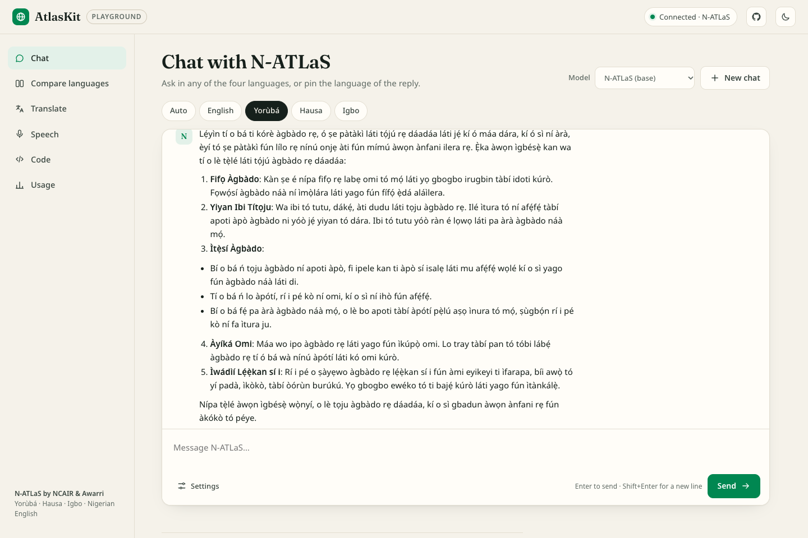
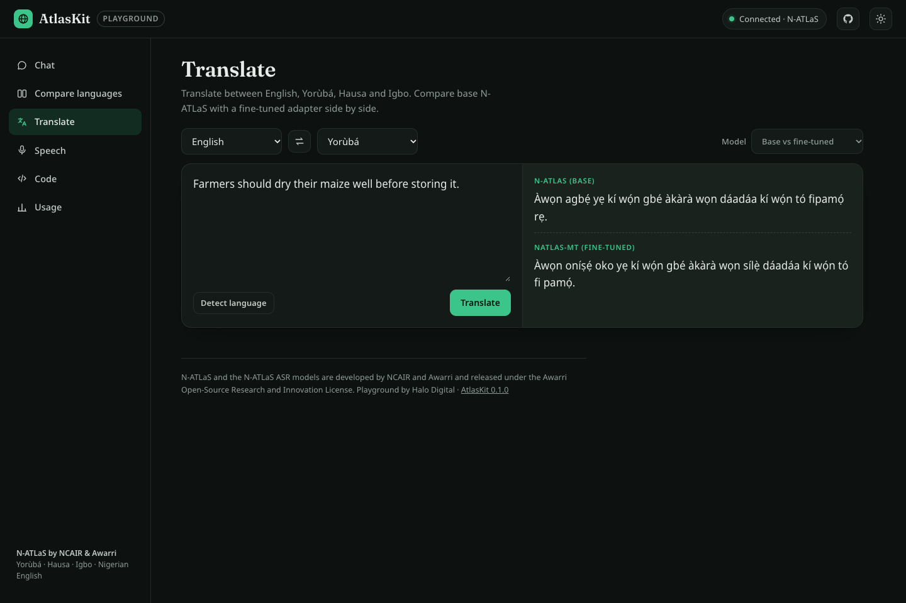

# AtlasKit: developer infrastructure for N-ATLaS

[](https://github.com/Lawalshalom/atlaskit/actions/workflows/tests.yml)

AtlasKit makes [N-ATLaS](https://huggingface.co/NCAIR1/N-ATLaS), Nigeria's open-source multilingual LLM, easy to build on. With it, a developer can go from "the weights are on Hugging Face" to "my app talks to N-ATLaS in Yoruba, Hausa, Igbo and Nigerian English" in minutes.

Built by **Halo Media and Digital Limited (Halo Digital)** for the National AI Innovation Challenge 2026, Problem Statement 01 (Developer Infrastructure).

| Component | What it does |
|---|---|
| **Gateway** (`gateway/`) | An OpenAI-compatible HTTP API in front of N-ATLaS served by vLLM. It also exposes the four official N-ATLaS ASR models as `/v1/audio/transcriptions`, and adds translation, summarisation, language detection and voice-chat endpoints. It includes API keys and a privacy-preserving usage log. |
| **Python SDK** (`sdk/python/`) | Zero-dependency client: `chat`, `stream`, `Conversation`, `transcribe`, `voice_chat`, `translate`, `summarize`, `detect_language`, plus an `atlaskit` CLI. |
| **JavaScript SDK** (`sdk/js/`) | Zero-dependency ESM client for Node 18+, Deno, Bun and browsers, with the same API. |
| **Playground** (`playground/`) | Browser UI served at `/`, in light or dark mode. It covers streaming chat with a model picker (base or fine-tuned), side-by-side comparison of all four languages, translation with base vs fine-tuned shown together, speech (upload or record), copy-paste code generation and usage stats. Each tab has a deep link, for example `/#speech`. |
| **Fine-tuning kit** (`finetune/`) | LoRA fine-tuning of N-ATLaS from OpenAI-format JSONL, rendered with N-ATLaS's own chat template. The adapter is served next to the base model and selected by name (`model="natlas-mt"`). |
| **Evaluation harness** (`eval/`) | Benchmarks one or more N-ATLaS deployments or adapters (for example base vs fine-tuned) on FLORES+ translation (chrF), FLEURS speech recognition (WER/CER), language ID and QA. It writes JSON and Markdown reports. |
| **RunPod deployment** (`deploy/runpod/`) | Two scripts take a GPU pod to a public HTTPS endpoint. |



<details><summary>Dark mode: base N-ATLaS vs the fine-tuned adapter in Translate</summary>



</details>

## Measured results

These come from live runs on one RTX PRO 4500 GPU on 12 Oct 2026. Details and raw outputs are in [`eval/results/2026-10-12/`](eval/results/2026-10-12/README.md).

- **Translation (FLORES+ devtest, 1,012 sentences per direction, chrF):** base N-ATLaS scores 48.89 for English → Hausa, 40.45 for English → Igbo and 26.55 for English → Yoruba. A 14-minute AtlasKit LoRA fine-tune raises these by **+1.21**, **+0.61** and **+1.20**. A paired bootstrap shows all three gains are significant.
- **Speech (FLEURS, 100 recordings per language):** the official N-ATLaS ASR models score a word error rate (WER) of 33.7% on Hausa, 36.9% on Igbo and 57.5% on Yoruba. Yoruba drops to 30.2% when tone marks are ignored.
- **Reliability:** 0 failed requests across 6,400+ benchmark requests.

## Why

N-ATLaS is downloadable, but every team that wants to use it currently has to repeat the same work:

- work out the Llama-3 chat template and its `date_string` argument;
- tune the generation settings from the model card;
- stand up an inference server;
- wire up four separate Whisper ASR checkpoints;
- write their own client.

AtlasKit does that once, in Nigeria, in the open.

The gateway speaks the OpenAI wire format, so existing code written for OpenAI-style APIs (LangChain, LlamaIndex, the OpenAI SDKs, n8n, and so on) can switch to N-ATLaS by changing the base URL. The gateway **only serves N-ATLaS**: a request for any other model is rejected with a 404, so a deployment can never quietly wrap a different foundation model.

## Quick start

### 1. Run N-ATLaS + gateway (GPU, e.g. RunPod)

```bash
export HF_TOKEN=hf_...            # account must have accepted the N-ATLaS + ASR model terms
export ATLAS_API_KEYS=key-for-tester-1,key-for-tester-2
bash deploy/runpod/setup.sh       # one-time: installs vLLM, downloads N-ATLaS + 4 ASR models
bash deploy/runpod/start.sh       # vLLM on :8000 (private), gateway + playground on :8080
```

See [docs/DEPLOY_RUNPOD.md](docs/DEPLOY_RUNPOD.md).

### 2. Use it from Python

```bash
pip install "git+https://github.com/Lawalshalom/atlaskit#subdirectory=sdk/python"   # or, from a clone: pip install ./sdk/python
```

```python
from atlaskit import AtlasKit

atlas = AtlasKit("https://<pod-id>-8080.proxy.runpod.net", api_key="key-for-tester-1")

print(atlas.chat("Explain how to store maize after harvest.", language="ha").text)

for delta in atlas.stream("Kedu ka m ga-esi chekwaa ego m?", language="ig"):
    print(delta, end="")

print(atlas.translate("Wash your hands before eating.", target="yo", source="en"))
print(atlas.transcribe("voice-note.ogg", language="yo")["text"])   # official N-ATLaS ASR
print(atlas.voice_chat("question.m4a", language="ha")["reply"])    # speech in, answer out

tutor = atlas.conversation(language="yo", system="You are a patient maths tutor.")
tutor.say("Kí ni 12 × 8?")
```

CLI: `atlaskit chat -l yo`, `atlaskit translate "Good morning" -t ha`, `atlaskit transcribe note.wav -l ig`.

### 3. Use it from JavaScript

```js
import { AtlasKit } from "atlaskit";            // npm install ./sdk/js

const atlas = new AtlasKit({ baseUrl: process.env.ATLASKIT_BASE_URL, apiKey: process.env.ATLASKIT_API_KEY });
const { text } = await atlas.chat("Ina son koyon kasuwanci", { language: "ha" });
for await (const d of atlas.stream("Ẹ kú àárọ̀", { language: "yo" })) process.stdout.write(d);
```

### 4. Or keep your existing OpenAI code

```python
from openai import OpenAI
client = OpenAI(base_url="https://<pod-id>-8080.proxy.runpod.net/v1", api_key="key-for-tester-1")
client.chat.completions.create(model="n-atlas", messages=[{"role": "user", "content": "Sannu"}],
                               extra_body={"atlas_language": "ha"})
```

## API

| Method | Path | Notes |
|---|---|---|
| GET | `/health` | Gateway + model status |
| GET | `/v1/models` | `n-atlas` and the four ASR models |
| POST | `/v1/chat/completions` | OpenAI-compatible, including streaming (SSE). Extension: `atlas_language` (`en`/`yo`/`ha`/`ig`) pins the reply language |
| POST | `/v1/audio/transcriptions` | multipart `file` + `language`; routed to `NCAIR1/{Yoruba,Hausa,Igbo}-ASR` / `NigerianAccentedEnglish` |
| POST | `/v1/atlas/voice-chat` | multipart audio → transcript + N-ATLaS reply in the same language |
| POST | `/v1/atlas/translate` | `{text, target, source?, model?}`. `model` picks a fine-tuned adapter |
| POST | `/v1/atlas/summarize` | `{text, language?, max_words?}` |
| POST | `/v1/atlas/detect-language` | `{text}` → `{language, confidence}` (fast heuristic; accuracy is measured in `eval/`) |
| POST | `/v1/atlas/feedback` | `{rating: 1 or -1, language?, tag?}`: thumbs up/down from apps or the playground |
| GET | `/v1/atlas/stats` | Aggregate usage (no prompt text is ever stored) |

Authentication: `Authorization: Bearer <key>` (or `X-API-Key`). Keys come from `ATLAS_API_KEYS`. Other settings are `ATLAS_UPSTREAM_URL`, `ATLAS_ENABLE_ASR`, `ATLAS_LOG_PATH` and `ATLAS_CORS_ORIGINS`.

## Development

```bash
python examples/dev_server.py        # gateway + playground against a mock model, no GPU needed
pytest tests                         # 27 tests: core logic, gateway end to end, Python SDK, JS SDK, eval harness, fine-tuning data
```

## Docs

- [Architecture](docs/ARCHITECTURE.md)
- [N-ATLaS integration evidence](docs/NATLAS_INTEGRATION.md)
- [Deploying on RunPod](docs/DEPLOY_RUNPOD.md)
- [Fine-tuning N-ATLaS with LoRA](finetune/README.md)
- [Evaluation harness](eval/README.md)
- [Beta testing guide](docs/BETA_TESTING.md)

## Licensing

AtlasKit's code is Apache-2.0. **N-ATLaS and its ASR models are not**: they are released by NCAIR and Awarri under the *Awarri Open-Source Research and Innovation License*. That license requires attribution, requires derivatives to use the same license, and caps use at 1,000 active end-users per 30 days without a commercial license from Awarri. AtlasKit does not redistribute any model weights. Each deployer downloads them under their own accepted terms.
